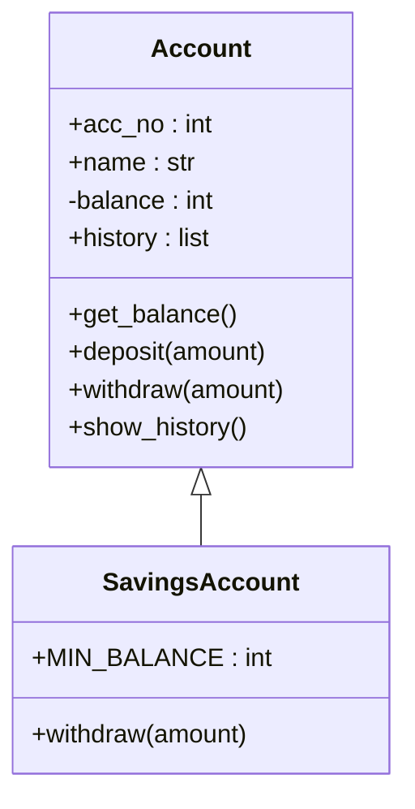

# Banking System (Python OOP)

A command-line banking application built with Object-Oriented Programming in Python. Users can create accounts, deposit, withdraw, check balance and view transaction history.

## Features
- Create a normal or savings account
- Deposit and withdraw money
- Check balance
- View transaction history
- Error handling for negative amounts, low balance and wrong input

## How to Run
1. Install Python 3.
2. Download this repository.
3. Open the folder in a terminal and run:
   python main.py

## Class Diagram

## Design Overview
- **Account** is the parent class. It stores the account number, holder name, a private balance and the transaction history.
- **SavingsAccount** inherits from Account and overrides `withdraw()` to keep a minimum balance of 500.
- **Encapsulation:** the balance is private (`__balance`) and can only be changed through `deposit()` and `withdraw()`.
- **Inheritance and polymorphism:** SavingsAccount reuses Account's methods and changes only the withdraw rule.
- **Error handling:** invalid amounts, low balance and wrong input are handled with `ValueError` and `try / except`, so the program does not crash.
- **Storage:** all accounts are kept in a dictionary (`account number : account object`).

  
## What I Learned
Classes and objects, constructors, encapsulation, inheritance, polymorphism and exception handling.

## Author
Neha Khatri

Made as part of the Codomax Digital Solutions Python Internship (Module 03).
